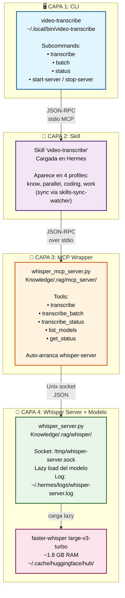

#  Whisper System — Transcripción local de video

> **TL;DR**: Sistema local de transcripción usando `faster-whisper large-v3-turbo`. Arquitectura de 3 capas (CLI → MCP → Server). Lazy load del modelo para ahorrar RAM. Sin APIs externas.

> **Migración (2026-09-09)**: este doc se movió desde `Knowledge/learning/transcription/` (eliminado). Backup en `~/.scratch/transcription-backup-2026-09-09/`.

---

##  Qué hace

Transcribe archivos de video (MP4, MKV, AVI, etc) a texto **100% local**, sin APIs externas. Genera:

- `<video>.transcript.md` (markdown con timestamps)
- `<video>.transcript.srt` (subtítulos estándar)

Con auto-clasificación (tipo: clase/tutorial) y auto-tagging (topics detectados).

---

##  Arquitectura (4 capas)

```
┌─────────────────────────────────────────────────────────┐
│  CAPA 1: video-transcribe (CLI en PATH)                │
│   ~/.local/bin/video-transcribe                         │
│   Subcommands: transcribe, batch, status, start/stop    │
└─────────────────────────────────────────────────────────┘
                │ (JSON-RPC stdio MCP)
                ▼
┌─────────────────────────────────────────────────────────┐
│  CAPA 2: skill "video-transcribe" (cargada en Hermes)  │
│   Aparece en 4 profiles (know, parallel, coding, work) (sync via skills-sync-watcher) │
└─────────────────────────────────────────────────────────┘
                │ (JSON-RPC over stdio)
                ▼
┌─────────────────────────────────────────────────────────┐
│  CAPA 3: whisper_mcp_server.py (MCP wrapper)            │
│   Knowledge/.rag/mcp_server/whisper_mcp_server.py       │
│   Tools: transcribe, transcribe_batch, list_models      │
│   Auto-arranca whisper-server si no está corriendo      │
└─────────────────────────────────────────────────────────┘
                │ (Unix socket JSON)
                ▼
┌─────────────────────────────────────────────────────────┐
│  CAPA 4: whisper_server.py (modelo)                     │
│   Knowledge/.rag/whisper/whisper_server.py              │
│   Socket: /tmp/whisper-server.sock                       │
│   Lazy load del modelo (1.8 GB)                        │
│   Logging a ~/.hermes/logs/whisper-server.log          │
└─────────────────────────────────────────────────────────┘
                │
                ▼
┌─────────────────────────────────────────────────────────┐
│  faster-whisper large-v3-turbo (~1.8 GB)               │
│   Modelos en ~/.cache/huggingface/hub/                  │
└─────────────────────────────────────────────────────────┘
```

**Diagrama de arquitectura (Mermaid)** — renderiza en Obsidian, GitHub y web vault:



---

##  Componentes

| Path | Función | Tamaño |
|---|---|---|
| `~/.local/bin/video-transcribe` | CLI standalone | 9.2 KB |
| `Knowledge/.rag/whisper/whisper_server.py` | Layer 4 (server) | 16.5 KB |
| `Knowledge/.rag/mcp_server/whisper_mcp_server.py` | Layer 3 (MCP wrapper) | 12.8 KB |
| `~/.cache/huggingface/hub/models--mobiuslabsgmbh--faster-whisper-large-v3-turbo` | Modelo default | 1.8 GB |
| `~/.cache/huggingface/hub/models--Systran--faster-whisper-base` | Modelo alternativo | ~150 MB |
| `~/.cache/huggingface/hub/models--Systran--faster-whisper-medium` | Alternativo | ~1.5 GB |
| `~/.cache/huggingface/hub/models--Systran--faster-whisper-small` | Alternativo | ~500 MB |
| `~/.config/systemd/user/whisper-server.service` | systemd unit | - |

---

##  Comandos CLI

### `video-transcribe transcribe`

```fish
video-transcribe transcribe <video_path> [--lang LANG] [--model MODEL]
```

**Ejemplo**:
```fish
video-transcribe transcribe ~/Videos/clase.mp4 --lang es --model large-v3-turbo
```

### `video-transcribe batch`

```fish
video-transcribe batch <directory> [--recursive] [--lang LANG] [--model MODEL]
```

**Ejemplo**:
```fish
video-transcribe batch ~/Videos/university/ --recursive --lang es
```

### `video-transcribe status`

```fish
video-transcribe status                    # estado del server
video-transcribe status --job <job_id>     # estado de un job específico
```

### `video-transcribe start-server` / `stop-server`

```fish
video-transcribe start-server    # arrancar manualmente
video-transcribe stop-server     # parar manualmente
```

---

##  MCP Tools (Layer 3)

El MCP server expone 5 tools JSON-RPC:

### `transcribe(video_path, lang, model)`

```json
{
  "action": "transcribe",
  "params": {
    "video_path": "/path/to/video.mp4",
    "lang": "es",
    "model": "large-v3-turbo"
  }
}
```

**Comportamiento**: Job-based. Nunca bloquea más de 240s (POLL_DEADLINE). Videos cortos devuelven resultado completo, largos devuelven `{status: "still_running", job_id}`.

### `transcribe_status(job_id)`

Single poll, always fast.

```json
{
  "action": "transcribe_status",
  "params": {"job_id": "abc123-def456"}
}
```

### `transcribe_batch(dir_path, recursive, lang, model)`

Arranca un job por video, devuelve job_ids inmediatamente.

### `list_models()`

Lista modelos faster-whisper disponibles.

### `get_status()`

Estado del server (uptime, model loaded, jobs activos).

---

##  Modelos y performance

| Modelo | Tamaño | Velocidad (RTF) | Uso |
|---|---|---|---|
| `large-v3-turbo` | 1.8 GB | 0.30-0.49 | Default, mejor calidad |
| `medium` | 1.5 GB | ~0.5 | Alternativo, balance |
| `small` | 500 MB | ~0.3 | Más rápido, menor calidad |
| `base` | 150 MB | ~0.2 | Liviano, baja calidad |

**RTF (Real-Time Factor)**: tiempo de procesamiento / duración del audio.
- RTF=0.30 = transcribe 10 min de audio en 3 min
- RTF=0.49 = transcribe 20 min de audio en 10 min

**Idioma**: español es el más común (B1 detection). Soporta 99 idiomas.

---

##  Configuración

### Variables de entorno

| Variable | Default | Función |
|---|---|---|
| `WHISPER_MCP_POLL_DEADLINE` | 240 | Timeout máximo de polling |
| `WHISPER_VENV_PYTHON` | auto-detect | Path al Python del venv |
| `SOCKET_PATH` | `/tmp/whisper-server.sock` | Unix socket del server |

### systemd unit

```ini
[Unit]
Description=Whisper transcription server
After=network.target

[Service]
Type=simple
ExecStart=/home/b3low-z3r0/Documents/Knowledge/.rag/venv/bin/python3 /home/b3low-z3r0/Documents/Knowledge/.rag/whisper/whisper_server.py
Restart=on-failure
SyslogIdentifier=whisper-server

[Install]
WantedBy=default.target
```

**Estado actual**: unit instalado pero **DISABLED** (start manual con `video-transcribe start-server`).

---

##  Outputs generados

### Markdown transcript

```markdown
---
title: "Cómo hacer algoritmos - Transcripción"
duration: "20:14"
language: "es"
model: "large-v3-turbo"
type: clase
tags: [algoritmos, pseint, programación, flowgorithm]
created: 2026-08-28
---

## Cómo hacer algoritmos

## Transcripción

[00:00] Introducción a los algoritmos...
[00:15] Un algoritmo es una secuencia de pasos...
...
```

### SRT subtitles

```srt
1
00:00:00,000 --> 00:00:15,000
Introducción a los algoritmos.

2
00:00:15,000 --> 00:00:30,500
Un algoritmo es una secuencia de pasos...
```

---

##  Troubleshooting

### "Model not found"

```fish
## Ver modelos disponibles
ls ~/.cache/huggingface/hub/

## Forzar descarga (primera vez tarda)
video-transcribe transcribe test.mp4 --model large-v3-turbo
```

### "Socket stale detected"

```fish
## Borrar socket y reiniciar
rm -f /tmp/whisper-server.sock
video-transcribe start-server
```

### "POLL_DEADLINE exceeded"

Si el video es muy largo (>30 min), el primer poll devuelve `still_running`. Esperar unos segundos y volver a pollejar con `transcribe_status(job_id)`.

---

##  Casos de uso reales

### Caso 1: Transcripción de clases (Universidad)

```fish
## Uny profile, vault Knowledge/university/
video-transcribe batch ~/Videos/university/ --recursive --lang es
## Genera .md + .srt por cada video
## Auto-clasifica como "clase", taggea topics
```

### Caso 2: Subtítulos para portfolio

```fish
## Coding profile, portfolio videos
video-transcribe transcribe ~/portfolio/demo.mp4 --lang en
## Genera .srt para incrustar en el sitio
```

---

##  Historial

| Fecha | Cambio |
|---|---|
| 2026-09-09 | Doc movido a `projects/system/whisper.md`. `transcription/` eliminado |
| 2026-08-28 | 4 transcripciones completadas (large-v3-turbo) |
| 2026-08-28 | Sistema completo implementado (4 capas) |

### Performance real (mediciones 2026-08-28)

| Video | Duración | Tiempo | RTF |
|---|---|---|---|
| Cómo hacer algoritmos | 20:14 | 7:42 | 0.38 |
| Pseint desde cero 2021 | 5:43 | 1:58 | 0.35 |
| PSeInt escribe ejecuta | 12:04 | 3:51 | 0.32 |
| PSeInt primeros pasos | 4:17 | 1:13 | 0.29 |
| **Total** | **42:18** | **14:44** | **0.34 promedio** |

---

## 🔗 Ver también

- [[learning/projects/hermes/system/mcps/argos-rag.md]]
- [[learning/projects/hermes/system/mcps/mcp-servers|system/mcps · mcp-servers]]
- [[learning/projects/projects-index.md]]
